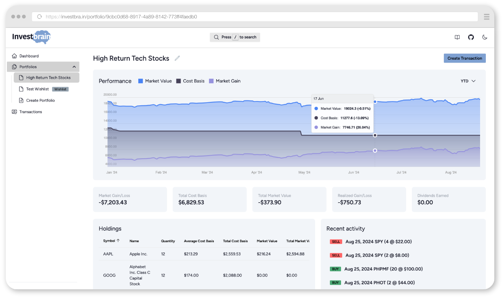

<p align="center"><a href="https://investbra.in" target="_blank"></a></p>

[](https://github.com/investbrainapp/investbrain/)
[](https://github.com/investbrainapp/investbrain/)
[](https://github.com/investbrainapp/investbrain/issues)
[](https://hub.docker.com/r/investbrainapp/investbrain/)


## About Investbrain

Investbrain is a smart open-source investment tracker that helps you manage, track, and make informed decisions about your investments.

<p align="center"><a href="https://investbra.in" target="_blank"></a></p>

## Getting started

There are two ways to use Investbrain:

- **Investbrain Cloud** - sign up at [investbra.in](https://investbra.in/register). There's nothing to install.
- **Self-hosted** - run it on your own server, NAS, or computer with Docker:

  ```bash
  curl -O https://raw.githubusercontent.com/investbrainapp/investbrain/main/docker-compose.yml
  docker compose up -d
  ```

  Then open `http://localhost:8000/register`. Read the [self-hosting guide](docs/self-hosting.md) for configuration, HTTPS, updates, and backups before exposing it to the internet.

## Documentation

Everything else is in the [docs](docs/README.md):

- [Getting started](docs/getting-started.md) - portfolios, sharing, transactions, holdings, dividends, splits, search, and AI chat
- [Account settings](docs/account-settings.md) - locale and display currency, two-factor authentication, social logins, and authorized apps
- [Import and export](docs/import-export.md) - backups, moving between instances, and bulk-loading transactions from a spreadsheet
- [REST API](docs/api.md) - API tokens and endpoints
- [MCP server](docs/mcp.md) - connecting AI assistants such as Claude, ChatGPT, Cursor, or VS Code
- [Self-hosting](docs/self-hosting.md) - installation, configuration options, market data providers, AI chat, updating, and command line utilities
- [Troubleshooting](docs/troubleshooting.md) - fixes for common problems
- [Contributing](docs/contributing.md) and [developing market data providers](docs/market-data-providers.md) - development setup, running tests, and making pull requests

## Contributing

We appreciate any contributions to Investbrain, from documentation and translations to bug fixes and new market data providers. The [contributing guide](docs/contributing.md) explains how to set up a development environment and what we look for in a pull request.

## Code of Conduct

We ask that you be kind and polite when interacting with the Investbrain community. 

## Security Vulnerabilities

If you discover a security vulnerability within Investbrain, please submit your report via [Github](https://github.com/investbrainapp/investbrain/security/advisories/new). All security vulnerabilities will be promptly addressed. We ask that you keep any suspected vulnerabilities private and confidential until they have been appropriately addressed.

## License

Investbrain is open-sourced software licensed under the [CC-BY-NC 4.0](https://github.com/investbrainapp/investbrain?tab=License-1-ov-file).
