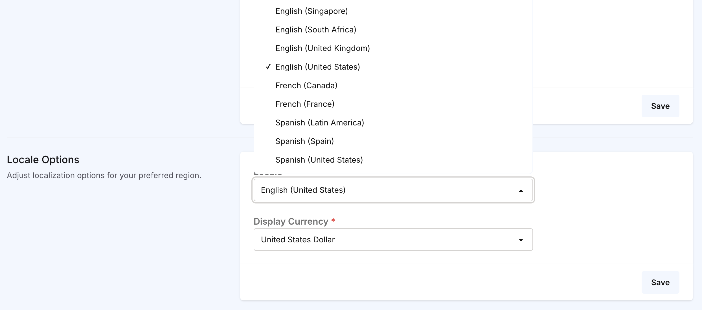
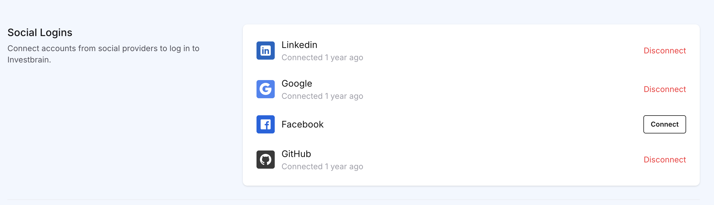
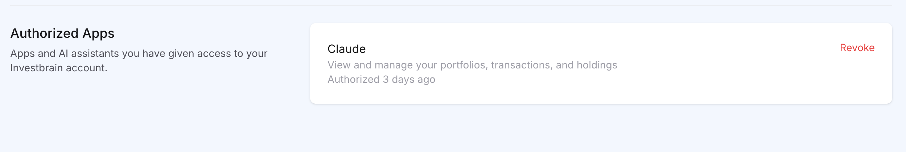

# Account Settings

Open the user menu at the bottom of the left sidebar to reach your account settings:

- **Manage Profile** - profile information, locale and display currency, password, two-factor authentication, and account deletion
- **Connections** - social logins and authorized apps
- **API Tokens** - personal access tokens for the [REST API](api.md)
- **Import / Export Data** - see [Import and export](import-export.md)

## Profile information

Under **Manage Profile** you can change your name and email address and upload a profile photo. Click **Save** once you're done.

## Locale and display currency

The **Locale Options** section on **Manage Profile** controls how Investbrain looks for you.

| Setting | What it does |
| --- | --- |
| **Locale** | Sets the interface language (English, French, or Spanish) and the regional format for numbers, dates, and currency symbols. For example, **English (United Kingdom)** and **English (United States)** use the same language but format numbers differently. |
| **Display Currency** | The currency used for dashboard and portfolio totals, summary cards, and performance charts. Amounts are converted from each security's trading currency using daily exchange rates. |

Changing your display currency doesn't change any stored data. It only changes how totals are presented to you, so you can switch back and forth freely. Individual holdings in the holdings table keep showing their own trading currency. See [Multiple currencies](getting-started.md#multiple-currencies) for more.

Your display currency is also the default currency when you create a new transaction from the Transactions page or a portfolio page.

## Updating your password

Under **Update Password**, enter your current password and the new password twice.

If you signed up with a social login, your account doesn't have a password yet. Use **Forgot your password?** on the login page to set one by email.

## Two-factor authentication

Two-factor authentication (2FA) adds a one-time code from your phone to the sign-in process. Any authenticator app that supports time-based codes works, such as Google Authenticator, 1Password, Authy, or Bitwarden.

## Social logins

Social logins let you sign in with GitHub, Google, Facebook, or LinkedIn instead of (or as well as) your password. The **Social Logins** section on the Connections page lists the providers that are available. On a self-hosted instance, providers only appear if you've [configured them](self-hosting.md#social-login).

### Connecting an account

1. Go to **Connections** in the user menu.
2. Under **Social Logins**, click **Connect** next to the provider.
3. Approve the request on the provider's site.

### Disconnecting an account

Click **Disconnect** next to the provider and confirm. You can reconnect at any time. Make sure you have a password set (or another provider connected) before disconnecting your only way to sign in.

## Authorized apps

The **Authorized Apps** section on the **Connections** page lists every app or AI assistant you've connected to your Investbrain account, such as an AI assistant connected through the [MCP server](mcp.md).

 

Click **Revoke** to cut off an app's access immediately. The app will need to ask for your permission again to reconnect.

## Deleting your account

At the bottom of **Manage Profile**, click **Delete Account** and enter your password to confirm. Your account, profile photo, API tokens, connected social accounts, and AI chat history are permanently deleted, your access to every portfolio is removed, and you're signed out.

This can't be undone. [Export your data](import-export.md#exporting-your-data) first if you might want it later.
