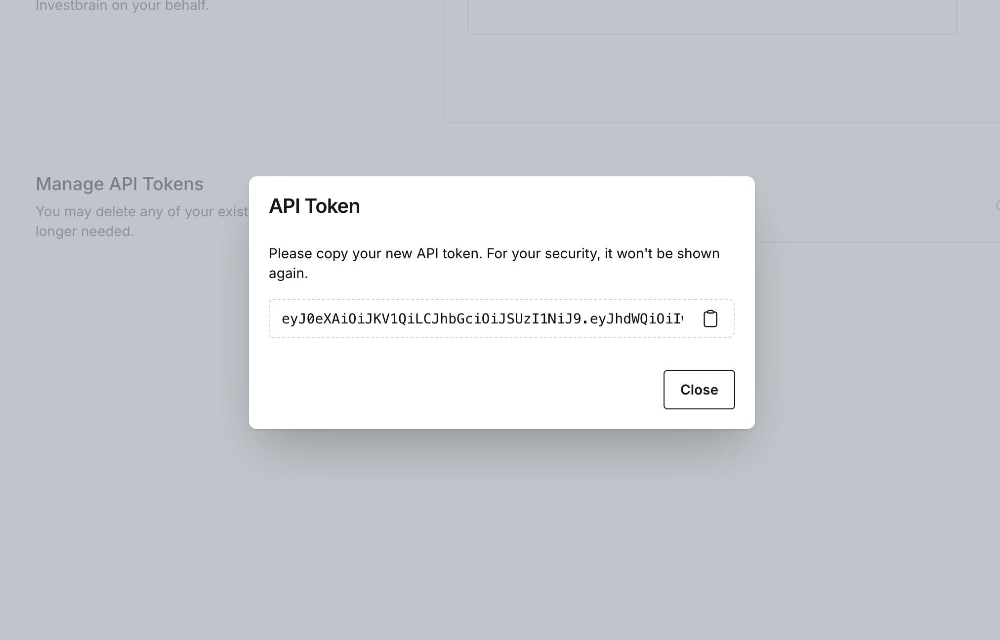

# REST API

Investbrain has a JSON REST API for reading and managing your portfolios, transactions, and holdings, and for looking up market data. Use it to build scripts, sync data from a brokerage, feed a spreadsheet, or integrate with other tools.

- [Creating an API token](#creating-an-api-token)
- [Making requests](#making-requests)
- [Pagination, sorting, filtering, and search](#pagination-sorting-filtering-and-search)
- [Endpoints](#endpoints)
- [Errors](#errors)
- [OpenAPI specification](#openapi-specification)

## Creating an API token

The API authenticates with personal access tokens.

1. Sign in to Investbrain and open **API Tokens** from the user menu (or go to `/user/api-tokens`). On Investbrain Cloud, you need to verify your email address before this page is available.
2. Under **Create API Token**, enter a **Token Name** that reminds you what it's for, such as "Home spreadsheet" or "Brokerage sync script".
3. Click **Create**.
4. Copy the token from the dialog. **It's only shown once.** If you lose it, delete it and create a new one.

 

The token acts as you: it can see and change everything your account can, across every portfolio you have access to. Keep it secret and don't commit it to source control.

### Managing tokens

The **Manage API Tokens** section on the same page lists your active tokens and when each was created. Click **Delete** next to a token to revoke it immediately. Any script using it will start receiving `401 Unauthorized` responses.

API tokens work only with the REST API. They can't be used with the [MCP server](mcp.md), which uses OAuth instead.

## Making requests

**Base URL**

| Where you use Investbrain | Base URL |
| --- | --- |
| Investbrain Cloud | `https://investbra.in/api` |
| Self-hosted | `https://<your-investbrain-host>/api` (for a default local install, `http://localhost:8000/api`) |

The examples on this page use Investbrain Cloud. If you self-host, replace `https://investbra.in` with your own address.

**Headers**

Send your token as a bearer token, and ask for JSON so errors are returned as JSON too:

```
Authorization: Bearer <your-token>
Accept: application/json
```

Send request bodies as JSON with `Content-Type: application/json`.

**Example: check that your token works**

_Request:_

```bash
curl https://investbra.in/api/me \
  -H "Authorization: Bearer $INVESTBRAIN_TOKEN" \
  -H "Accept: application/json"
```

_Response:_

```json
{
  "id": "3f8e2b4c-...",
  "name": "Jane Doe",
  "email": "jane@example.com",
  "profile_photo_url": "https://...",
  "options": {
    "display_currency": "USD",
    "locale": "en_US"
  },
  "created_at": "2025-01-04T18:22:10.000000Z",
  "updated_at": "2026-10-30T09:12:45.000000Z"
}
```

Single records are returned as a plain JSON object. Lists are wrapped in `data` with pagination details (see below).

## Pagination, sorting, filtering, and search

The three list endpoints (`GET /portfolio`, `GET /transaction`, and `GET /holding`) share the same query parameters.

| Parameter | Example | Description |
| --- | --- | --- |
| `page` | `page=2` | Page number, starting at 1. |
| `itemsPerPage` | `itemsPerPage=50` | Results per page. Default 15, maximum 100. |
| `sort` | `sort=-date,symbol` | Comma-separated columns. Prefix with `-` for descending. |
| `filter[<name>]` | `filter[symbol]=AAPL,MSFT` | Exact match. Separate values with commas to match any of them. For true/false filters, use `true`/`false` or `1`/`0`. |
| `search` | `search=apple` | Case-insensitive partial match on the endpoint's search columns. |

Using a sort or filter that isn't supported for that endpoint returns a `422` validation error listing the allowed values.

Without `sort`, results come back in no particular order. If you page through results, pass `sort` so the order stays the same from page to page.

List responses look like this (`links` and `meta` are shortened here):

```json
{
  "data": [ { "...": "..." } ],
  "links": {
    "first": "https://investbra.in/api/transaction?page=1",
    "last": "https://investbra.in/api/transaction?page=4",
    "prev": null,
    "next": "https://investbra.in/api/transaction?page=2"
  },
  "meta": {
    "current_page": 1,
    "last_page": 4,
    "per_page": 15,
    "total": 52
  }
}
```

The `links` keep your other query parameters, so you can follow `next` until it's `null` to read every page.

## Permissions

The API follows the same permissions as the web app: you can read any portfolio you have access to, but creating, changing, or deleting anything requires [full access](user-guide.md#access-levels) to the portfolio.

## Errors

| Status | Meaning |
| --- | --- |
| `200 OK`, `201 Created`, `204 No Content` | Success. `201` is returned when a portfolio or transaction is created, and `204` after a delete. |
| `401 Unauthorized` | Missing, invalid, expired, or revoked token. |
| `403 Forbidden` | You don't have access to that portfolio, or you only have read-only access and tried to change something. |
| `404 Not Found` | The record doesn't exist, or the symbol isn't recognized. |
| `422 Unprocessable Content` | Validation failed. See the `errors` object for details. |

Validation errors look like this:

```json
{
  "message": "The quantity must not be greater than the available quantity.",
  "errors": {
    "quantity": ["The quantity must not be greater than the available quantity."]
  }
}
```

If you get an HTML login page instead of a JSON error, add the `Accept: application/json` header.

## OpenAPI specification

Machine-readable OpenAPI specifications of the API is kept in this repository: [`openapi.json`](../openapi.json) for API v2 (Investbrain 1.4.0 and later). 

You can import into Postman, Insomnia, or Bruno to browse endpoints and try requests. 

If the spec and this page ever disagree, please [open an issue](https://github.com/investbrainapp/investbrain/issues).
