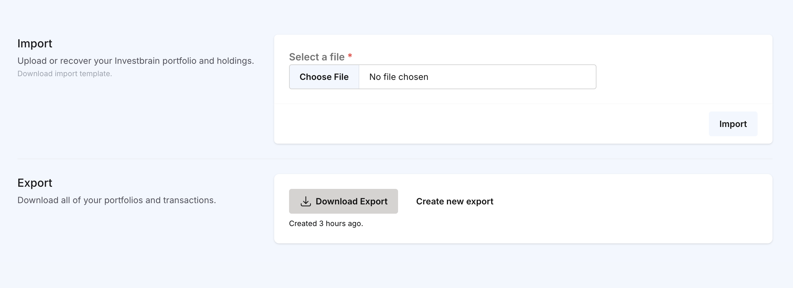
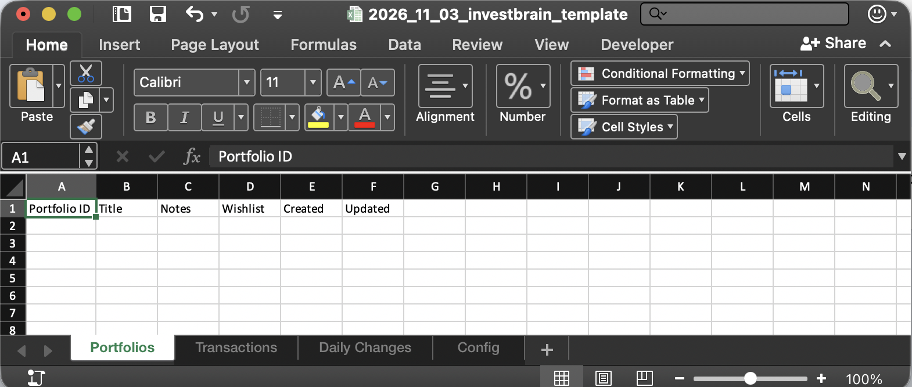
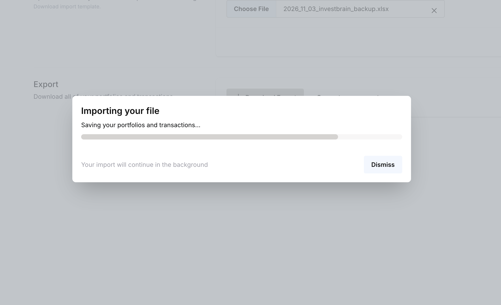

# Import and Export

Investbrain can export everything in your account to a single Excel workbook and import that workbook back. Use it to:

- Keep regular backups of your portfolios and transactions
- Move your data between Investbrain Cloud and a self-hosted instance (in either direction), or from one self-hosted instance to another
- Bulk-load years of transaction history from a spreadsheet instead of typing it in
- Make bulk edits to existing transactions

Open **Import / Export Data** from the user menu to get started. On Investbrain Cloud, you need to verify your email address before this page is available.

<!-- SCREENSHOT: The Import / Export page showing the Import section (with the Download import template link) and the Export section. -->
<!--  -->

## Exporting your data

1. Click **Generate Export**. Investbrain builds the workbook in the background, so large accounts don't time out. You can leave the page while it's being prepared and come back later.
2. When it's ready, click **Download Export**. Hover over the button to see when the export was created.

You'll get a file named like `2026_11_01_investbrain_backup.xlsx` containing:

- Every portfolio you have access to, including portfolios shared with you
- Every transaction in those portfolios
- Each portfolio's daily history: market value, cost basis, realized gains, dividends earned, and any annotations
- Your profile settings: name, locale, display currency, and which holdings have dividend reinvestment turned on

Things to know:

- **An export can be downloaded for 24 hours.** After that it's deleted, and you can generate a new one.
- **Only your latest export is kept.** Clicking **Generate new export** replaces the previous file.
- **The download link only works for your account.** Other people, including those you share portfolios with, can't use it.
- **One export at a time.** While an export is being prepared, you can't start another one. You can start up to three exports per minute.
- If something goes wrong, the page says so and shows a **Try again** button.

On a self-hosted instance, exports are built by the queue workers inside the `app` container and stored in the `storage` volume until they expire.

## Importing into Investbrain

Investbrain imports `.xlsx` workbooks of up to 2 MB. The easiest starting point is the import template: click **Download import template** on the Import / Export page to get an empty workbook with the right sheets and headings. An Investbrain export uses the same format, so you can also add rows to an existing export and import it again.

<!-- SCREENSHOT: The downloaded template open in Excel or LibreOffice with the Transactions sheet selected and the Portfolios, Transactions, Daily Changes, and Config tabs visible. -->
<!--  -->

### Running an import

1. Click **Select a file** and choose your workbook.
2. Click **Import**.

A progress dialog shows each step as the import reads your file, checks it for problems, looks up any symbols Investbrain doesn't know yet, and saves your data. The import runs in the background, so you can click **Dismiss** and keep using Investbrain. While it runs, a progress tab follows you to other pages, and it tells you when the import has finished. You'll also get an email when it succeeds or fails. On a self-hosted instance, that email is only sent once you've [set up email](self-hosting.md#email).

<!-- SCREENSHOT: Import progress dialog part-way through, for example while importing transactions. -->
<!--  -->

After the import finishes, Investbrain refreshes dividends for the imported holdings, recalculates them, and rebuilds each portfolio's daily history in the background. On a large import this can take several minutes, so charts and totals may fill in gradually.

You can start up to three imports per minute.

### How imports work

- **Only fill in the sheets you need.** Every sheet is optional, and a sheet you don't need can be left empty or removed. Most people only need the Transactions sheet. The Portfolios sheet is useful when you want the import to create or update portfolios. The Daily Changes and Config sheets are only needed to restore a backup.
- **Keep the sheet names and the heading row as they are.** Columns are matched by their heading, so their order doesn't matter and extra columns are ignored. A sheet that's missing a required column is reported once, rather than on every row.
- **Rows are created or updated.** A row with a blank ID is created as a new record. A row whose ID matches an existing record updates that record. Importing never deletes anything, so rows you remove from the spreadsheet stay in Investbrain.
- **The whole file is checked before anything is saved.** If anything is wrong, nothing is imported. The import page lists every problem with its sheet, row, column, and the value that caused it, so you can fix them all and upload the file again. The page shows up to 100 problems, and the failure email lists the first 10. Because nothing was saved, it's safe to import the same file again once it's fixed.
- **Problems stay on the page until you dismiss them.** If an import fails while you're on another page, the progress tab links to the list of problems.

## Portfolios sheet

| Column | Required | Description |
| --- | --- | --- |
| Portfolio ID | Optional | Leave blank to create a new portfolio. Use an existing ID to update that portfolio. You can also enter a new UUID of your own, so that the Transactions sheet can refer to the portfolio (see [Referring to portfolios](#referring-to-portfolios)). Each ID can only appear once. |
| Title | Required | The name of the portfolio, up to 255 characters. |
| Notes | Optional | Free text. |
| Wishlist | Optional | `TRUE` or `FALSE`. Defaults to `FALSE`. |
| Created, Updated | Optional | Included in exports for reference. Ignored on import. |

## Transactions sheet

| Column | Required | Description |
| --- | --- | --- |
| Transaction ID | Optional | Leave blank to add a new transaction. Use an existing ID to update that transaction. Each ID can only appear once. |
| Symbol | Required | The ticker as your market data provider lists it, such as `AAPL`, `BRK-B`, or `VOD.L`. |
| Portfolio ID | Required | The ID of a portfolio in the Portfolios sheet of the same file, or in your account. |
| Transaction Type | Required | `BUY` or `SELL`. |
| Quantity | Required | Number of shares. Must be greater than zero, except on split rows (see [Stock splits](#stock-splits)). |
| Cost Basis | Optional | Price paid per share. Leave blank or use `0` for shares you received for free. Leave blank on `SELL` rows to use your average cost (see [Sales](#sales)). |
| Sale Price | Optional | Price received per share. Only used for `SELL` rows. |
| Currency | Optional | Currency of the prices, such as `USD`. Defaults to the currency the symbol trades in (see [Currencies](#currencies)). |
| Split | Optional | `TRUE` if the row records shares added or removed by a stock split. Defaults to `FALSE`. |
| Reinvested Dividend | Optional | `TRUE` if the row is a `BUY` paid for with a dividend. Defaults to `FALSE`. |
| Date | Required | Trade date, such as `2024-03-15`. Excel date cells work too. Dates in the future aren't accepted. |
| Created, Updated | Optional | Included in exports for reference. Ignored on import. |

### Referring to portfolios

The Portfolio ID column must contain a portfolio's ID (a UUID such as `9d6c1f3e-5b1a-4c0e-8f5e-2a7b9c3d4e5f`). Portfolio titles aren't accepted. To get an ID:

- **For an existing portfolio**, open it in Investbrain and copy the ID from the address bar (`/portfolio/<id>`), or take it from an export.
- **For a new portfolio**, generate a UUID yourself (for example with `uuidgen` or an online UUID generator). Put it in the Portfolio ID column on the Portfolios sheet, and use the same value on the Transactions sheet.

IDs are matched without regard to case. You can only import into portfolios that you own or that have been shared with you with full access. The same goes for updating an existing transaction: you need full access to the portfolio it currently belongs to.

### Currencies

Leave the Currency column blank and Investbrain uses the currency each symbol trades in, which is the safest choice. If you fill it in, use that same trading currency, such as `USD` for `AAPL` or `GBX` (pence) for most London-listed shares. Unlike the transaction form in the app, imports don't convert a price from another currency into the trading currency, so a price entered in a different currency shows up with the wrong value.

### Reinvested dividends

Record a reinvested dividend as a `BUY` row with Reinvested Dividend set to `TRUE`. Set Quantity to the number of shares bought and Cost Basis to the price paid per share.

You don't need rows for cash dividends. Investbrain works out dividends earned from your market data provider's dividend history and the shares you held on each date.

### Stock splits

Record a split as a `BUY` row with Split set to `TRUE` and a Cost Basis of `0`. Set Quantity to the number of extra shares you received. For example, a 2-for-1 split of 10 shares is a split row with a Quantity of 10.

For a reverse split, use a negative Quantity for the shares you gave up. For example, a 1-for-10 reverse split of 100 shares is a split row with a Quantity of -90. Split rows can't have a Quantity of zero.

Include rows for every split that happened while you held the shares. Investbrain detects splits automatically only for dates after the import, so it won't add earlier ones for you.

### Sales

A `SELL` row can't sell more shares than the portfolio holds on that date. Shares already in your account count, and purchases on the same day count toward the shares held.

If you leave Cost Basis blank on a `SELL` row, Investbrain uses the average cost of the shares bought before the sale, just like the transaction form.

### Symbols

Every symbol must be known to your market data provider. Symbols Investbrain hasn't seen before are looked up during the check, and any it can't find are reported as problems. Symbols can contain letters, numbers, and `. - ^ = : / _`, with no spaces, up to 25 characters.

## Daily Changes sheet

This sheet stores your portfolios' daily history and is only needed to restore a backup. Market values are recalculated after the import, so only these columns are read:

| Column | Required | Description |
| --- | --- | --- |
| Date | Required | The day the row describes. |
| Portfolio ID | Required | The ID of the portfolio. You need full access to it. |
| Annotation | Optional | A note for that day. |

## Config sheet

This sheet stores your account settings and is only needed to restore a backup.

| Column | Required | Description |
| --- | --- | --- |
| Key | Required | One of `name`, `locale`, `display_currency`, or `reinvested_dividends`. Other keys are ignored. |
| Value | Required | The value for that setting. For `reinvested_dividends`, a JSON list of holdings, such as `[{"portfolio_id": "...", "symbol": "SCHD"}]`. |

## Formatting tips

- Spreadsheet date cells and text dates such as `2024-03-15` both work.
- `BUY` and `SELL` can be in any case, and symbols are converted to upper case.
- For true/false columns, `TRUE`/`FALSE`, `Yes`/`No`, and `1`/`0` are all accepted. A blank cell means `FALSE`.
- Currency symbols such as `$`, `€`, `£`, or `¥` and spaces in front of prices are removed. Don't use thousands separators: `1,000` isn't read as a number.
- Formulas are fine. The import uses their calculated values.
