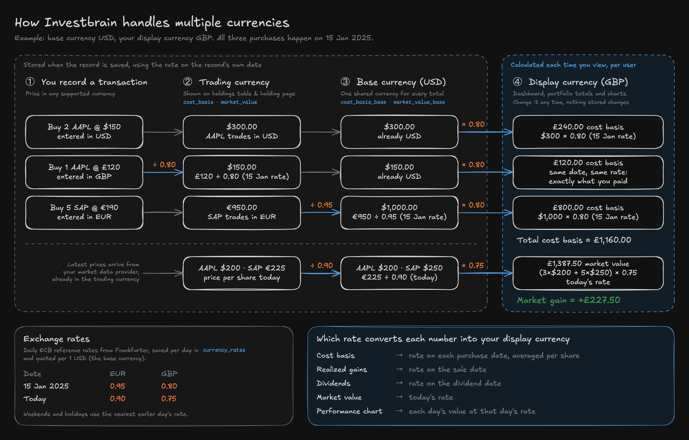

# How Multi-Currency Works

You can hold securities that trade in different currencies, record transactions in any supported currency, and see your totals in the currency of your choice. This page explains how the numbers get from one currency to another.

## The four currencies

| Currency | What it is | Where you see it |
| --- | --- | --- |
| **Transaction currency** | The currency you type a price in when you record a transaction. | The create-transaction form. |
| **Trading currency** | The currency the security trades in, as reported by your market data provider (for example USD for `AAPL`, EUR for `SAP`). | The holdings table and holding page. |
| **Base currency** | A single currency set for the whole instance (`BASE_CURRENCY`, USD by default). Every amount is also stored in it so totals can be added up across holdings. | Nowhere. It's used internally. |
| **Display currency** | Your personal choice under [Locale and display currency](account-settings.md#locale-and-display-currency). | Dashboard and portfolio totals, summary cards, and performance charts. |

## What happens when you save a transaction

1. **Transaction currency to trading currency.** If you enter a price in a different currency from the one the security trades in, Investbrain converts it using the exchange rate on the transaction date. A purchase of `AAPL` entered as £120 on a day when 1 USD = 0.80 GBP is stored as $150.
2. **Trading currency to base currency.** The trading-currency amount is converted again, at the same date's rate, and stored alongside it.

Dividends follow the same path using the dividend date, and the latest market prices are converted to the base currency at today's rate whenever they're refreshed.

Because both conversions use the rate from the record's own date, editing your display currency later never changes anything that's stored.

## What happens when you view your portfolio

Totals are converted from the base currency into your display currency every time you load a page. The rate depends on what's being converted:

| Number | Exchange rate used |
| --- | --- |
| Cost basis | The rate on each purchase date, averaged across the shares you still hold |
| Realized gains | The rate on the sale date |
| Dividends | The rate on the dividend date |
| Market value | Today's rate |
| Performance chart | Each day's market value at that day's rate; cost basis at the purchase-date rates |

This means your cost basis reflects what you actually paid in your display currency, while market value moves with both the share price and today's exchange rate. Exchange-rate movements therefore show up in your market gain.

In the example above, all three purchases cost £1,160 in total on 15 Jan 2025. Today the shares are worth $1,850, which at today's rate of 0.75 is £1,387.50, a market gain of £227.50.

## Exchange rates

Investbrain uses daily reference rates from [Frankfurter](https://frankfurter.dev/), which publishes European Central Bank rates. Rates are refreshed once a day and saved for each date, so a historic rate only has to be fetched once.

- There are no rates on weekends or bank holidays. Investbrain uses the closest earlier day's rate instead.
- Frankfurter has no rates before 4 January 1999.
- Some exchanges quote prices in minor units. Investbrain has built-in aliases for GBX (British pence), ZAC (South African cents), and RMB (Chinese yuan) and adjusts them automatically.

## Self-hosted instances

The base currency is set with `BASE_CURRENCY` and should be chosen before you add any data. See [Currency](self-hosting.md#currency) for details. To add a currency that isn't in the seeded list, see [Custom currencies](custom-currencies.md).
